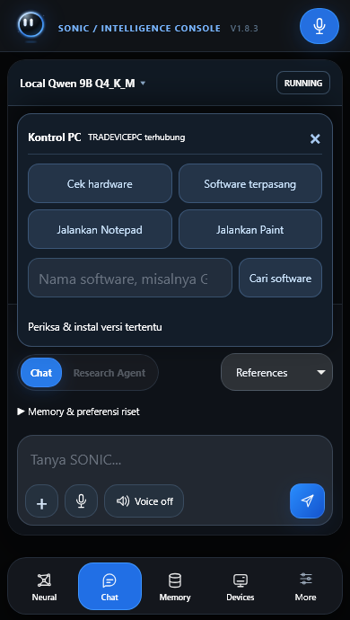
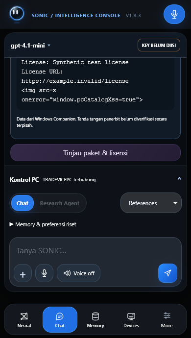

# SONIC 1.8.3: recoverable local replies and PC controls

## Problem and evidence

The local engine was healthy while the browser displayed “Load failed”.
Staging logs included HTTP 499 after 65,023 ms (client disconnected before a
response), while local inference logs included roughly 69–71 second runs.
This proves a disconnected long request; it does not identify whether Safari,
navigation or the network caused the close.

## Changed behavior

Owner chat now has durable, session-bound request IDs, short local acceptance
responses and authenticated polling. Network failures and gateway 502/504
responses reconcile the same request with GET. Reload never automatically
resubmits a model job or installer. Browser storage contains only the random
request ID and timestamp.

Receipt acceptance and settlement preserve terminal outcomes under concurrent
requests. Job creation and its recovery link commit together. Exactly one
assistant answer and usage record are retained. Engine runs and steps remain
queued until a real receipt proves completed or failed. Local requests do not
fall back to a cloud model.

Chat includes a PC controls sheet above the composer: status, inventory, package
search, exact-version inspection and supported app launch. Inspection metadata,
publisher/license output, package/version/source, requested user scope and
restart policy appear as text in chat. Installation consumes the authenticated
inspected plan, source/package consent and separate exact approval. Batal
dispatches no installer; success requires matching authenticated inventory
evidence. Model output never becomes an executable command.

## Verification

| Check | Observed result |
|---|---|
| Full Python suite on Windows | 695 passed, 8 skipped, 1 dependency deprecation warning |
| Focused delivery regression | 20 passed; 2 PostgreSQL cases skip without their dedicated URL |
| Chromium and WebKit delivery | Passed at 390×690, 360×640 and 1440×900 |
| Lost POST response / accepted POST with 502 or 504 | Same job recovered after reload; one submission and one final answer |
| Open controls and expanded installation form | Composer unchanged; summary, input and send hit targets accessible |
| PC flow in both browser engines | Inspection, inert catalog HTML, consent, exact review, cancellation, approval, verified receipt, draft retention and reload approval recovery passed |
| Existing GGUF loopback smoke | HTTP 202 in 168 ms; actual installed model returned “12” in 6,046 ms |
| Real Windows Notepad proof | New Notepad process after synthetic authenticated approval; visible target verified, authenticated receipt retained as done |

The GGUF and Notepad checks use disposable loopback SONIC backends and synthetic
credentials with real local execution. They do not use a live Railway owner
session. No software installer ran. Notepad remained open after the proof
process exited; the MT5 process snapshot was unchanged.

The installed Companion GUI flag was enabled and its existing limited scheduled
task restarted. The model remained healthy and idle with its original PID.
The ordinary future entry point was restored. Privileges, software flags and
model configuration were preserved. This does not claim the replacement broker
acquired the surviving model process handle.

## Continuous verification

The new workflow runs two PostgreSQL concurrency tests in an isolated schema of
the explicitly named disposable sonic_delivery_ci database. It also runs both
browser engines and the synthetic PC flow, uploading screenshots and JSON
reports. Deployment must wait for these checks on the exact commit.

    python -m pytest -q
    SONIC_QA_BROWSER=chromium python scripts/e2e_chat_delivery_v183.py
    SONIC_QA_BROWSER=webkit python scripts/e2e_chat_delivery_v183.py
    SONIC_QA_BROWSER=chromium python scripts/e2e_pc_agent_v183.py
    SONIC_QA_BROWSER=webkit python scripts/e2e_pc_agent_v183.py

The manual real-PC proof requires explicit opt-in:

    python scripts/qa_live_pc_notepad_v183.py --run-notepad

Windows pytest may need a fresh --basetemp and -p no:cacheprovider when old
temporary directories belong to another session.

## Visual evidence

Synthetic owner/device data only.

## Limits

Desktop WebKit at an iPhone-sized viewport is not physical iPhone/Safari testing.
Browser tests use synthetic Companion receipts. Real Notepad execution does not
prove an installer succeeded. A short arithmetic smoke is not a general local
model speed or refusal benchmark.
